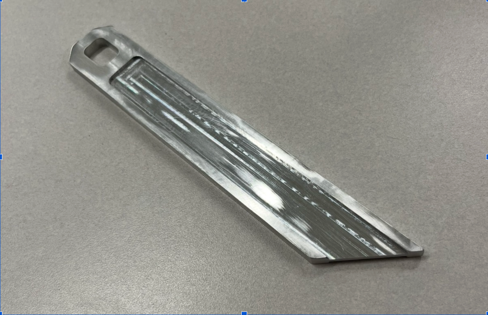
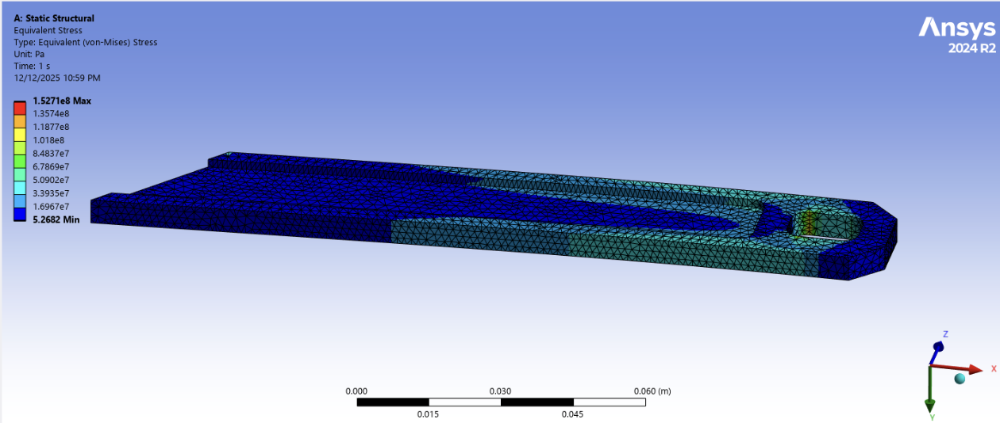

# Lightweight Aluminum Wrench

Designing, analyzing, machining, and testing an aluminum wrench under geometric and weight constraints.

**Status:** Completed · Sep–Dec 2025  
**Role:** Team member  
**Tools:** SOLIDWORKS · Ansys FEA · Manual machining

## Project images

*Machined aluminum wrench.*

*Ansys Static Structural analysis — equivalent (von Mises) stress distribution.*

## Objective

Design and optimize an aluminum wrench to meet specified geometric constraints and a target weight, then evaluate the fabricated part through physical testing.

## My contributions

As a team member, I designed and optimized the wrench in SOLIDWORKS, performed hand stress analysis and Static Structural FEA in Ansys, and manually machined the final part. I also participated in three-point bend and functional torque testing and presented the work in a final report and poster.

## Methodology

1. Develop and refine the wrench geometry in SOLIDWORKS against geometric and weight requirements.
2. Use hand stress calculations and Static Structural FEA in Ansys to assess the safety factor before fabrication.
3. Manually machine the final aluminum part.
4. Evaluate the part through three-point bend and functional torque tests.
5. Document the design, analysis, fabrication, and testing in a final report and poster.

## Results and current status

The project was completed in December 2025. The supplied resume documents a fabricated wrench, physical testing, and a final report and poster. Numerical test results and pass/fail outcomes are not included in the available source.

## Limitations

No numerical mass, safety factor, load capacity, or test-success claim is presented without the original report. Contributions are described within a team project.

## Source basis

ARIYEH_WEISSMAN-BENNETT_RESUME2026.docx.pdf, supplied November 11, 2026. Project images supplied November 12, 2026 show the machined wrench and Ansys stress analysis. The wrench report, CAD files, and test records were not supplied.

## Repository contents

This README documents the project. CAD files, the report, poster, and test records can be added after review; they are not included in this release.
